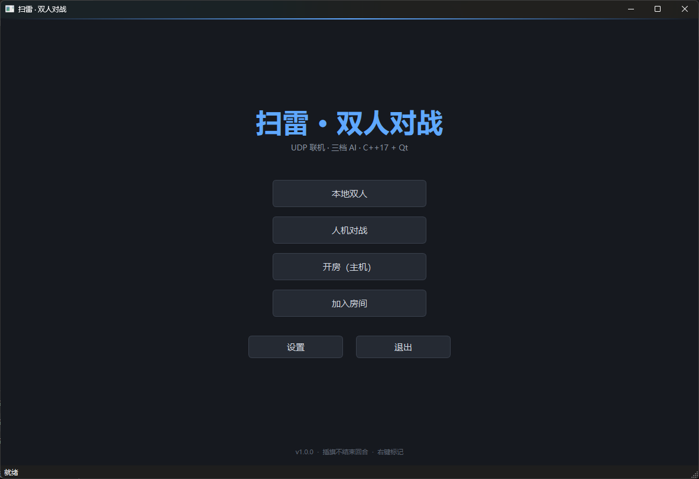
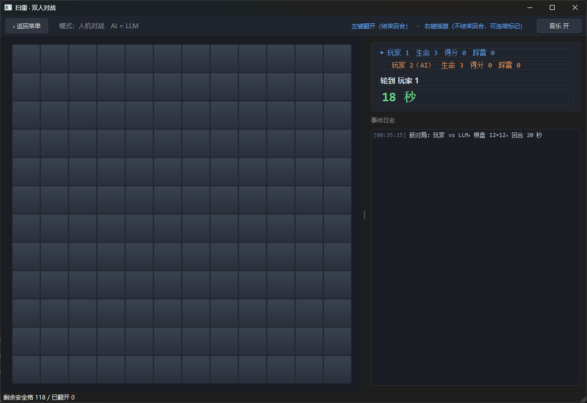

# MinesweeperUDP

UDP 联机双人对战扫雷 · C++17 + Qt 6 · 程序化 8-bit 音乐

一款支持**局域网双人对战**、**人机对战**和**三档 AI 难度**的扫雷游戏。
规则引擎、网络协议、AI 全部与界面解耦，可独立单元测试。

| 标题菜单 | 对局界面 |
|---|---|
|  |  |

<sub>左：标题菜单（本地双人 / 人机对战 / 开房 / 加入房间 / 设置）。
右：对局中——左侧棋盘（数字为周围雷数，橙色旗为玩家 2 标记），
右侧为双方生命与得分、回合倒计时、事件日志。</sub>

---

## 玩法

双方轮流操作，各自有回合时间限制：

- **左键**翻开格子：安全格 +1 分；踩雷扣 1 点生命。**翻开是唯一结束回合的操作**
- **右键**插旗标记：**不结束回合**，可在同一回合内连续标记多个格子；
  双方都能看到对方的旗，也可以覆盖对手的标记
- **干扰**：消耗自己的回合时间（3 秒），让对手下一回合少 3 秒（每局限 1 次）
- **结束**：一方生命归零立即结束；或安全格全部翻开
- **胜负**：分高者胜；平分比剩余生命；再平则平局

---

## 界面结构

启动后进入**标题菜单**，选择模式：

| 菜单项 | 说明 |
|---|---|
| 本地双人 | 同一台机器两人轮流操作 |
| 人机对战 | 与 AI 对局（难度在设置里切换） |
| 开房（主机） | 监听 UDP 端口，等待对手加入 |
| 加入房间 | 填写主机 IP 与端口加入 |
| 设置 | 回合时间、棋盘、雷密度、生命值、AI、网络 |

游戏页顶部有「‹ 返回菜单」，随时可以退出当前对局回到标题页。

**设置项**（自动保存，下次启动恢复）：

- 棋盘尺寸：8×8 / 12×12 / 16×16 / 20×20
- 雷密度：0.08 ~ 0.35
- 初始生命：1 ~ 9
- **回合时间：5 ~ 180 秒**
- 是否允许干扰
- AI 难度与 LLM 参数（接口地址 / Key / 模型）
- 网络：主机地址、端口

---

## 背景音乐（程序化合成）

项目**不包含任何音频文件**。所有音乐由代码实时合成，以 16-bit PCM 推给 `QAudioSink`：

| 构件 | 说明 |
|---|---|
| 波形 | 方波（主旋律）/ 三角波（低音）/ 白噪声（打击乐） |
| 包络 | ADSR（起音 5ms / 衰减 60ms / 延音 0.55 / 释放 40ms），避免音符边缘爆音 |
| 音高 | 十二平均律，`midiToFreq(69) = 440Hz` |
| 混音 | 多音轨求和 + `tanh` 软限幅，防止削波 |
| 播放 | `QAudioSink` + `QIODevice::readData()` 拉流，天然处理欠载 |

**两首曲目**（原创五声音阶循环）：

- **主菜单主题**：C 大调五声（C-D-E-G-A），方波旋律 + 三角波根音走动，约 16 拍循环
- **对局主题**：A 小调五声，速度更快，加了噪声打点营造紧张感

控制方式：
- 游戏页右上角 **「音乐 开 / 关」** 按钮
- 设置 → 音乐 里可调音量（0–100，默认 45%）

> 之所以不用现成歌曲：任何商业音乐都有版权，随代码公开分发存在法律风险。
> 程序化合成没有素材、没有版权问题，而且体积为 0。

---

## 三档 AI

| 难度 | 原理 | 说明 |
|---|---|---|
| Random | 在所有可翻开格中均匀随机 | 无信息时的理论最优，作为对照组 |
| **Probability** | **约束推理** | 从已翻开数字反推「必是雷 / 必安全」，含子集推理 |
| LLM | 大模型 API | 失败自动降级到 Probability |

### ProbabilityAI 的推理逻辑

**单约束**：对每个已翻开的数字格 `n`，其邻居中 `unknown` 个未知、`flagged` 个已知旗，
则剩余未知格中必有 `n - flagged` 个雷：
- `n - flagged == unknown` → 全是雷（可以标旗）
- `n - flagged == 0` → 全安全（可以放心翻）

**子集推理**：若约束 A 的未知集合 ⊂ 约束 B，且两者所需雷数相同，
则 `B \ A` 中的格子必然安全。这一步能解出单约束解不出的局面。

复杂度 `O(N·8) + O(C²·|U|)`，30×30 以内完全够用。
不做指数级枚举——工程上收益远小于复杂度。

---

## 架构

```
┌─────────────────────────────────────────────────────────┐
│  UI 层（Qt Widgets）                                     │
│    MainWindow      控制面板 / 模式切换 / 计时 / 日志      │
│    BoardWidget     QWidget + QPainter 自绘棋盘           │
└────────────┬────────────────────────────────────────────┘
             │ 只读 GameState，通过 RuleEngine 或 Session 操作
┌────────────▼───────────┐  ┌─────────────────────────────┐
│  core（纯 C++17）       │  │  net（socket，无 Qt 依赖）   │
│    Board     雷区生成   │  │    Protocol    帧设计/分片   │
│    GameState 完整状态   │  │    UdpSocket   跨平台封装    │
│    RuleEngine 全部规则  │  │    HostSession 主机权威      │
│                         │  │    ClientSession 客户端      │
└────────────┬───────────┘  └─────────────────────────────┘
┌────────────▼───────────────────────────────────────────┐
│  ai（纯 C++，可单测）                                   │
│    RandomAI / ProbabilityAI / LlmAI                     │
└────────────────────────────────────────────────────────┘
```

**关键设计：`core` / `net` / `ai` 三层完全不依赖 Qt Widgets。**
因此可以在控制台里跑 147 项单元测试，不需要图形环境。

---

## 目录结构

```
UdpMinesweeper/
├── CMakeLists.txt
├── run.bat                      一键编译（clean / test / deploy）
├── deploy.bat                   收齐 Qt + MinGW 运行库
├── src/
│   ├── main.cpp
│   ├── core/                    规则引擎（零依赖）
│   │   ├── Types.h              enum class 定义
│   │   ├── Board.h/.cpp         雷区生成（mt19937 + Fisher-Yates）
│   │   ├── GameState.h/.cpp     完整状态 + 紧凑序列化
│   │   └── RuleEngine.h/.cpp    翻格 / 洪泛 / 插旗 / 干扰 / 胜负
│   ├── net/                     UDP 联机（零 Qt 依赖）
│   │   ├── Protocol.h           帧设计、分片重组
│   │   ├── UdpSocket.h/.cpp     WinSock2 / POSIX 双实现
│   │   ├── HostSession.h/.cpp   主机权威
│   │   └── ClientSession.h/.cpp 客户端 + ACK 重发
│   ├── ai/                      三档 AI
│   │   ├── IAI.h                策略接口
│   │   ├── RandomAI.h/.cpp
│   │   ├── ProbabilityAI.h/.cpp 约束推理
│   │   └── LlmAI.h/.cpp         大模型 + 可注入 HTTP
│   ├── audio/                   程序化音乐
│   │   ├── Synth.h/.cpp         波形合成 + ADSR + 渲染
│   │   ├── MusicLibrary.h/.cpp  内置曲目（代码写旋律）
│   │   └── MusicPlayer.h/.cpp   QAudioSink 播放
│   └── ui/
│       ├── BoardWidget.h/.cpp   QPainter 自绘棋盘
│       ├── MenuScene.h/.cpp     标题菜单
│       ├── Settings.h/.cpp      设置持久化（QSettings）
│       ├── SettingsDialog.h/.cpp 设置对话框
│       └── MainWindow.h/.cpp    场景容器 + 游戏页
└── tests/
    ├── core_tests.cpp           55 项
    ├── net_tests.cpp            44 项（含真实 UDP loopback 对局）
    └── ai_tests.cpp             48 项
```

---

## 环境要求

| 组件 | 版本 |
|---|---|
| Qt | 6.8.1（mingw_64），需要 Core / Gui / Widgets / **Multimedia** |
| 编译器 | MinGW g++ 13.1.0 |
| CMake | ≥ 3.21 |
| Ninja | 任意版本 |

> **路径不要包含中文**。Qt 的 `moc` 在 Windows 上无法在非 ASCII 路径生成文件。

---

## 编译

```bat
run.bat            :: 增量编译
run.bat clean      :: 清理后全量编译
run.bat test       :: 编译 + 跑三套单元测试
run.bat deploy     :: 编译 + windeployqt（生成绿色版目录）
```

产物在 `build\bin\`。

### 手动编译

```bat
set QT_ROOT=E:\MySofts\Qt
set PATH=%QT_ROOT%\Tools\mingw1310_64\bin;%QT_ROOT%\6.8.1\mingw_64\bin;%PATH%

cmake -S . -B build -G Ninja ^
  -DCMAKE_BUILD_TYPE=Release ^
  -DCMAKE_PREFIX_PATH=%QT_ROOT%\6.8.1\mingw_64 ^
  -DCMAKE_MAKE_PROGRAM=%QT_ROOT%\Tools\Ninja\ninja.exe ^
  -DCMAKE_CXX_COMPILER=%QT_ROOT%/Tools/mingw1310_64/bin/g++.exe

cmake --build build --parallel
```

---

## 联机怎么玩

**同一台机器测试（两个窗口）：**
1. 窗口 A：模式选「联机 · 开房（主机）」，端口 9527 → 开始新对局
2. 窗口 B：模式选「联机 · 加入房间（客户端）」，地址 127.0.0.1，端口 9527 → 开始新对局

**局域网两台机器：**
- 主机：记下自己内网 IP（`ipconfig`），开房
- 客户端：填主机的内网 IP + 同一端口
- 如果连不上：检查 Windows 防火墙是否拦截了该 UDP 端口

---

## 网络协议设计

**主机权威（Host Authoritative）**：客户端只发请求，结果以主机快照为准。
客户端不会自己改状态，因此即使被篡改也不影响对局。

**为什么用 UDP 而不是 TCP**：回合制游戏的丢包代价是重发一条消息；
TCP 的队头阻塞在弱网下体验更差，且长连接要处理 NAT 超时。

**可靠性分层**：
- 操作请求（Action）：带序列号，未收到 ACK 则 300ms 后重发，最多 5 次
- 状态快照（Snapshot）：不可靠，后一帧覆盖前一帧；超过 1200 字节自动分片

**雷区不传输**：双方用同一个 `seed` 各自生成，省带宽且保证完全一致。

---

## 测试

```bat
build\bin\core_tests.exe     :: 58 项 —— 规则引擎
build\bin\net_tests.exe      :: 44 项 —— 协议 + 真实 UDP 对局
build\bin\ai_tests.exe       :: 48 项 —— 三档 AI
build\bin\audio_tests.exe    :: 27 项 —— 波形 / 包络 / PCM 渲染 / 循环
```

合计 **177 项断言**，全部不依赖图形环境。

网络测试用 loopback 真实收发，验证了：握手、快照同步、非法操作拒绝、
客户端看到的状态与主机一致。

---

## 已知限制

- **回合时间只在本地递减**，主机与客户端的剩余秒数可能略有偏差（未做时间同步）
- 联机模式未实现断线重连：客户端断线后需要重新开房
- LLM 的 HTTP 走 `curl` 子进程，会阻塞当前调用；生产环境应改为异步
- 干扰机制目前只有「时间惩罚」一种，`interfereKind` 字段保留了扩展位
- 未做观战模式与回放

---

## License

MIT
